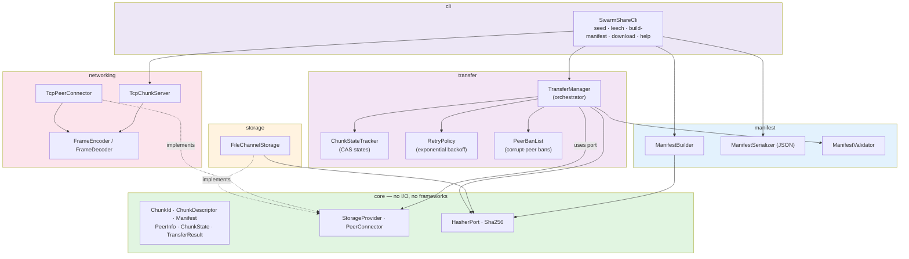

# swarm-share-lite — Design, Implementation & Java Reference

> **Language:** Java 25 (virtual threads, records, sealed types, pattern matching)
> **Platform:** Linux · JVM or GraalVM native executable
> **Philosophy:** Learn distributed systems by building one. Simple design, extensible boundaries.

This document is the specification of swarm-share-lite and the reference for how
it is built. Sections 1–17 describe the system as implemented; sections 18–21 are
a study companion. Decisions taken where this document was silent or ambiguous
are recorded in [`docs/ASSUMPTIONS.md`](docs/ASSUMPTIONS.md).

---

## Table of Contents

1. [Vision & Goals](#1-vision--goals)
2. [Core Concepts](#2-core-concepts)
3. [Architecture & Clean Boundaries](#3-architecture--clean-boundaries)
4. [Domain Model](#4-domain-model)
5. [Port Interfaces](#5-port-interfaces)
6. [Chunk Lifecycle State Machine](#6-chunk-lifecycle-state-machine)
7. [Storage Layer](#7-storage-layer)
8. [Networking & Wire Protocol](#8-networking--wire-protocol)
9. [Concurrency Model](#9-concurrency-model)
10. [Transfer Orchestration](#10-transfer-orchestration)
11. [Resilience & Retry](#11-resilience--retry)
12. [Manifest Builder, Serialization & Validation](#12-manifest-builder-serialization--validation)
13. [Command-Line Interface](#13-command-line-interface)
14. [Project Structure](#14-project-structure)
15. [Build Configuration](#15-build-configuration)
16. [Testing Strategy](#16-testing-strategy)
17. [Phased Roadmap](#17-phased-roadmap)
18. [Java Feature Refresher](#18-java-feature-refresher)
19. [Design Patterns Used](#19-design-patterns-used)
20. [Known Hard Problems & Solutions](#20-known-hard-problems--solutions)
21. [Learning Curriculum Map](#21-learning-curriculum-map)

---

## System Architecture Diagram



Dependencies point inward only. `core` depends on nothing; adapters
(`storage`, `networking`) implement its ports; `transfer` orchestrates through
the ports; `cli` wires concrete adapters together.

---

## 1. Vision & Goals

### The problem

Copying a large file to many machines is a serial bottleneck when only one or two
sources exist. A 300 GB game on 2 machines in a 14-machine LAN: the naive approach
takes 13× the time of a single copy.

### The insight

**Every receiver can become a sender.** A machine that holds a verified copy can
serve it, so the number of sources grows as the file spreads, and total transfer
time grows roughly with the logarithm of the number of machines instead of
linearly.

```
Round 1:  [A] ───► [B]   [A] ───► [C]          1 source  → 2 new copies
Round 2:  [A] [B] [C] each serve another peer   3 sources → 3 new copies
Round 3:  6 sources ...
```

In v1 the unit of "becoming a sender" is a whole file: once `leech` finishes,
that machine can `seed` the file. Serving individual chunks *while* still
downloading (peer promotion) is described here as the direction of travel but is
not part of the v1 roadmap (see [§17](#17-phased-roadmap)).

### Goals

- Split large files into fixed-size chunks and reassemble them exactly.
- Verify integrity with SHA-256 per chunk **and** for the whole file.
- Download from many peers concurrently on virtual threads.
- Survive failures: retry, fail over, ban corrupt peers, resume partial downloads.
- Strict clean architecture: business logic never touches the network or disk directly.

### Non-goals (v1)

- No DHT or tracker — a static peer list given on the command line.
- No NAT traversal.
- No TLS or encryption (the `PeerConnector` port is the extension point).
- No GUI — CLI only.
- No persistent peer state (bans and failure counts last for one transfer).

---

## 2. Core Concepts

### Chunk

A chunk is a fixed-size slice of the original file. Every chunk is exactly
`chunkSize` bytes except the last, which may be shorter.

```
File (10 MiB, chunkSize = 1 MiB)
┌───────┬───────┬───────┬───────┬───────┬───────┬───────┬───────┬───────┬───────┐
│ chunk │ chunk │ chunk │ chunk │ chunk │ chunk │ chunk │ chunk │ chunk │ chunk │
│   0   │   1   │   2   │   3   │   4   │   5   │   6   │   7   │   8   │   9   │
└───────┴───────┴───────┴───────┴───────┴───────┴───────┴───────┴───────┴───────┘
offset 0  1048576  2097152 ...                                       9437184
```

Each chunk has an **index** (0-based), a byte **offset**, a **size**, and the
**SHA-256** of its bytes.

### Manifest

The manifest is the swarm's contract: every peer must agree on it before any
chunk moves. It is a small JSON file written by the seeder.

```json
{
  "fileHash" : "1ce251bb506e10558235cf3feade0c868b215d47bd9c18523c58737db433f5fd",
  "fileName" : "ubuntu.iso",
  "totalSize" : 10485760,
  "chunkSize" : 1048576,
  "chunks" : [ {
    "index" : 0,
    "offset" : 0,
    "size" : 1048576,
    "sha256" : "c20cd2e6df572f5ececbb5c3687e330c3fc7f66c76c039978156be2f0461ba11"
  }, ...
  ]
}
```

`fileHash` is the SHA-256 of the whole file. It doubles as the swarm identifier
on the wire: a peer only answers requests for the manifest it serves.

### Peer

A peer is any node in the swarm. It has a `UUID` and an address. A **seeder**
listens on a TCP port and serves chunks; a **leecher** connects to peers to
download the chunks it is missing.

### Piece map (BitSet)

`java.util.BitSet` records which chunk indices a peer holds — bit `i` set means
"I have chunk `i`". Peers exchange piece maps so a leecher can plan which peer to
ask for each chunk.

```
Peer holds chunks 0, 2, 3, 7
BitSet:  1 0 1 1 0 0 0 1 0 0
index:   0 1 2 3 4 5 6 7 8 9
```

---

## 3. Architecture & Clean Boundaries

### The dependency rule

The domain defines **ports** (interfaces); infrastructure provides **adapters**
(implementations). The domain never imports infrastructure. This is the Ports &
Adapters (hexagonal) architecture.

```
┌───────────────────────────────────────────────────────────────┐
│                       TransferManager                         │
│                    (orchestration, transfer)                  │
└─────────────┬──────────────────────────────┬──────────────────┘
              │                              │
      ┌───────▼────────┐             ┌───────▼─────────┐
      │ PeerConnector  │             │ StorageProvider │   ports (core)
      │  <<interface>> │             │  <<interface>>  │
      └───────┬────────┘             └───────┬─────────┘
              │ implements                   │ implements
      ┌───────▼─────────┐            ┌───────▼───────────┐
      │ TcpPeerConnector│            │ FileChannelStorage│   adapters
      │  (networking)   │            │     (storage)     │
      └─────────────────┘            └───────────────────┘
```

### Module graph (enforced by Gradle)

```
cli ──► transfer ──► manifest ──► core
 │          └──────────────────► core
 ├─► networking ──► core
 ├─► storage ──────► core
 └─► manifest
```

| Module | Responsibility | Depends on |
|--------|----------------|------------|
| `core` | Domain records, ports, `HasherPort`/`Sha256` | — |
| `manifest` | Build, (de)serialize and validate manifests | `core`, Jackson |
| `storage` | `FileChannelStorage`: positional file I/O, resume scan | `core` |
| `networking` | Binary framing, `TcpChunkServer`, `TcpPeerConnector` | `core` |
| `transfer` | `TransferManager`, state tracking, retry, bans | `core`, `manifest` (validator) |
| `cli` | picocli commands; wires adapters together | everything |

### Why this matters

- `TransferManager` is tested with in-memory fakes — no disk, no network.
- `TcpPeerConnector` could be swapped for a TLS connector, or `FileChannelStorage`
  for object storage, without touching orchestration.
- Each module compiles on its own; circular dependencies cannot be expressed.

---

## 4. Domain Model

All domain types live in `core` and are immutable records with validating
compact constructors.

```java
/** Globally unique identity of a chunk: the same index in two manifests is two chunks. */
public record ChunkId(String manifestHash, int index) {
    public ChunkId {
        if (manifestHash == null || manifestHash.isBlank())
            throw new IllegalArgumentException("manifestHash must not be blank");
        if (index < 0)
            throw new IllegalArgumentException("index must be >= 0");
    }
}

/** One chunk of a manifest. Created once by the seeder, read by every peer. */
public record ChunkDescriptor(ChunkId id, long offset, int size, String sha256) {
    public ChunkDescriptor {
        if (offset < 0) throw new IllegalArgumentException("offset must be >= 0");
        if (size <= 0)  throw new IllegalArgumentException("size must be > 0");
    }
}

/** The swarm's contract. fileHash is the SHA-256 of the whole file. */
public record Manifest(String fileHash, String fileName, long totalSize,
                       int chunkSize, List<ChunkDescriptor> chunks) {
    public Manifest {
        chunks = List.copyOf(chunks); // defensive, unmodifiable copy
    }
    public int totalChunks() { return chunks.size(); }
    public ChunkDescriptor chunkAt(int index) { return chunks.get(index); }
}

/** Identity and address of a swarm participant. */
public record PeerInfo(UUID id, InetSocketAddress address) {
    public String displayAddress() { return address.getHostString() + ":" + address.getPort(); }
}

/** Lifecycle of one chunk during a transfer (see §6). */
public enum ChunkState { MISSING, SCHEDULED, IN_FLIGHT, VERIFYING, VERIFIED, WRITTEN }

/** Outcome of one download attempt; sealed, so callers must handle both cases. */
public sealed interface TransferResult permits TransferResult.Success, TransferResult.Failure {
    record Success(ChunkId id, byte[] data) implements TransferResult {}
    record Failure(ChunkId id, String reason, boolean shouldRetry) implements TransferResult {}
}
```

Hashing is a port too, so the domain stays free of `MessageDigest` details:

```java
public interface HasherPort {
    String compute(byte[] data);                    // lowercase hex
    boolean verify(byte[] data, String expectedHex); // constant-time comparison
}
```

`Sha256` implements it. It allocates a fresh `MessageDigest` per call — cheap
next to the hashing itself, and free of shared state — and compares digests with
`MessageDigest.isEqual` so a mismatch leaks no timing information. It also hashes
an `Iterator<byte[]>` so the whole-file hash can be streamed chunk by chunk.

---

## 5. Port Interfaces

The only surface between the domain and the outside world.

```java
public interface StorageProvider {
    /** Size the output file before any chunk is written; keeps an existing same-size file for resume. */
    void preallocateSpace(long totalSize);

    /** Write chunk bytes at their offset. Safe concurrently for disjoint ranges. */
    void writeChunk(ChunkId id, long offset, byte[] data);

    /** Read chunk bytes to serve or verify; empty if they are not there. */
    Optional<byte[]> readChunk(ChunkId id, long offset, int size);

    /** Resume support: bit i is set iff chunk i is on disk and matches its hash. */
    BitSet checkExistingChunks(Manifest manifest);

    /** Durably persist completed writes (no-op for in-memory storage). */
    default void flush() {}
}

public interface PeerConnector {
    /** Fetch one chunk; completes exceptionally on timeout, refusal, error status or bad length. */
    CompletableFuture<byte[]> fetchChunkAsync(PeerInfo peer, ChunkId id, int size);

    /** Fetch the peer's piece map for a manifest. */
    CompletableFuture<BitSet> fetchPieceMapAsync(PeerInfo peer, String manifestHash);
}
```

| Port | Production adapter | Test doubles |
|------|-------------------|--------------|
| `StorageProvider` | `FileChannelStorage` | `InMemoryStorage`, `SeederFileStorage` |
| `PeerConnector` | `TcpPeerConnector` | `FakePeerConnector` (scriptable misbehaviour) |
| `HasherPort` | `Sha256` | — |

---

## 6. Chunk Lifecycle State Machine

```
              orchestrator schedules the chunk
   MISSING ─────────────────────────────────► SCHEDULED
      ▲                                           │ virtual thread starts I/O
      │                                           ▼
      │                                       IN_FLIGHT
      │   network error, checksum mismatch,       │ bytes received
      │   or write error → retry or give up       ▼
      ├─────────────────────────────────────  VERIFYING
      │                                           │ SHA-256 matches
      │                                           ▼
      │                                       VERIFIED
      │                                           │ FileChannel write at offset
      │                                           ▼
      └ (resume: valid on disk) ────────────►  WRITTEN ── bit set in heldChunks
```

`ChunkStateTracker` keeps the state per `ChunkId` in a `ConcurrentHashMap` and
moves it with an atomic compare-and-swap:

```java
public boolean transition(ChunkId id, ChunkState expected, ChunkState next) {
    return states.replace(id, expected, next); // succeeds only from `expected`
}
```

A failed attempt can die in `IN_FLIGHT`, `VERIFYING` or `VERIFIED` (a write
error after verification), so the retry path uses `reset(id, SCHEDULED)` rather
than a CAS. Failure counts are `AtomicInteger`s.

---

## 7. Storage Layer

`FileChannelStorage` writes and reads chunks at explicit offsets in a single
pre-allocated file.

**Why `FileChannel`?** `write(buffer, position)` and `read(buffer, position)` do
not move a shared file pointer, so virtual threads can write disjoint chunks of
the same file concurrently with no lock. `FileOutputStream` has one cursor and
would serialize every write.

| Operation | Behaviour |
|-----------|-----------|
| `preallocateSpace(n)` | Creates parent directories and the file. A file already exactly `n` bytes is left untouched (it may be a partial download). A shorter file is extended, a longer one truncated. |
| `writeChunk` | Loops until every byte is written, then `force(true)` so a completed chunk survives a crash. Requires `preallocateSpace` first. |
| `readChunk` | Positional read; `Optional.empty()` if the file is shorter than the range. Without `preallocateSpace` the file is opened **read-only** — the seeder path, which must never write to the file it serves. |
| `checkExistingChunks` | Reads and hashes every chunk range; only matching chunks are reported. |
| `close` | Terminal: later reads/writes throw `IllegalStateException` instead of silently reopening the file. |

Swapping, lazily opening and closing the channel is guarded by a
`ReentrantLock` — opening a file is blocking I/O, which must not happen under
`synchronized` (§20.5). Positional reads and writes take no lock.

### Resume needs no metadata

On restart, `checkExistingChunks` re-hashes every chunk range of the output file.
Chunks that match are kept; torn or never-written chunks fail their hash and are
downloaded again. The file itself is the recovery log.

---

## 8. Networking & Wire Protocol

Plain TCP, big-endian integers (`DataInputStream`/`DataOutputStream` defaults).
Each connection carries **one request and one response**, then closes — stateless
and simple; connection pooling is a possible later optimisation.

### Message types

| Code | Message | Direction |
|------|---------|-----------|
| `0x01` | `PIECE_MAP_REQUEST` | leecher → peer |
| `0x03` | `CHUNK_REQUEST` | leecher → peer |

Requests start with their type byte. Responses do **not**: on a one-request
connection the pairing is implicit, so a response starts with its status.

### Frames

```
PIECE_MAP_REQUEST
┌──────────┬──────────────────┬──────────────────┐
│ 0x01     │ hash length      │ manifest hash    │
│ 1 byte   │ 4 bytes BE       │ N bytes UTF-8    │
└──────────┴──────────────────┴──────────────────┘

CHUNK_REQUEST
┌──────────┬──────────────────┬──────────────────┬──────────────┐
│ 0x03     │ hash length      │ manifest hash    │ chunk index  │
│ 1 byte   │ 4 bytes BE       │ N bytes UTF-8    │ 4 bytes BE   │
└──────────┴──────────────────┴──────────────────┴──────────────┘

RESPONSE (both kinds)
┌──────────┬──────────────────┬──────────────────────────────────────────┐
│ status   │ payload length   │ payload: chunk bytes or BitSet bytes     │
│ 1 byte   │ 4 bytes BE       │ N bytes (0 unless status is OK)          │
└──────────┴──────────────────┴──────────────────────────────────────────┘
```

### Status codes

| Status | Meaning | Sent when |
|--------|---------|-----------|
| `0x00` OK | Payload follows | Chunk bytes, or `BitSet.toByteArray()` of held chunks |
| `0x01` NOT_FOUND | The peer cannot serve this | Unknown manifest hash, index out of range, chunk not held, bytes not on disk |
| `0x02` ERROR | The request failed | Unknown message type; internal failure while serving (e.g. storage error) |

### Limits and timeouts

| Guard | Value | Why |
|-------|-------|-----|
| Manifest hash length | ≤ 256 bytes | Rejects hostile lengths before allocating (SHA-256 hex is 64) |
| Piece-map payload | ≤ 1 MiB | Describes 8 million chunks; anything larger is hostile |
| Chunk payload | must equal the manifest's chunk size | A stale or lying peer is rejected before reading the bytes |
| Client connect + read timeout | 10 s | A dead peer cannot stall a download thread forever |
| Server read timeout per connection | 10 s | An idle or half-open client cannot pin a handler and a file descriptor |

### Partial reads

A TCP `read` may return fewer bytes than asked. `FrameDecoder.readExactly` loops
until the buffer is full and fails on end-of-stream — or on a zero-byte read,
which would otherwise spin forever.

### Server and client

- **`TcpChunkServer`** — `bind()` opens the socket (so "address already in use"
  surfaces immediately and `port 0` resolves to a real port), `serve()` runs the
  accept loop, `start()` does both. Each connection is handled on its own virtual
  thread. `close()` stops accepting and waits for in-flight handlers before the
  caller closes storage.
- **`TcpPeerConnector`** — each fetch runs on its own virtual thread, opens a
  socket, sends one request, validates status and length, and reads exactly the
  payload. Errors carry the peer address, e.g.
  `Chunk fetch failed: chunk 3 from 10.0.0.7:7070: Peer returned status 0x01`.

---

## 9. Concurrency Model

### Virtual threads

A platform thread costs about 1 MB of stack and a kernel thread; a virtual thread
costs a few KB. Blocking I/O on a virtual thread parks it and frees the carrier
thread, so the code stays plain and blocking while scaling to thousands of
concurrent transfers.

```
Carrier (platform) threads ≈ CPU cores
        ▲ mount / unmount
Virtual threads ≈ one per chunk download, one per server connection
        ▲ run
Plain blocking code: Socket.read(), FileChannel.write()
```

### Where concurrency lives

| Mechanism | Used for |
|-----------|----------|
| `Executors.newVirtualThreadPerTaskExecutor()` | One virtual thread per missing chunk; one per accepted connection; one per outgoing fetch |
| `Semaphore(32)` | Back-pressure: at most 32 chunk transfers in flight, across all peers |
| `ConcurrentHashMap.replace(k, expected, next)` | Lock-free CAS state transitions — two threads can never both schedule a chunk |
| `AtomicInteger` | Failure counters per chunk and per peer |
| `synchronized (heldChunks)` | Updating/reading the held-chunk `BitSet` — tiny critical sections with **no I/O inside** |
| `ReentrantLock` | `FileChannelStorage` channel lifecycle, because opening a file is I/O |

```java
// The executor's close() waits for every chunk thread to finish.
try (var executor = Executors.newVirtualThreadPerTaskExecutor()) {
    for (ChunkDescriptor chunk : missing) {
        executor.submit(() -> downloadWithRetry(chunk, source, pieceMaps));
    }
}

// Inside each download thread:
inflightLimit.acquireUninterruptibly(); // parks the virtual thread, not a carrier
try {
    // fetch → verify → write
} finally {
    inflightLimit.release();            // always, even on failure
}
```

The retry back-off sleep happens **after** releasing the permit, so a waiting
chunk never blocks another chunk's transfer.

---

## 10. Transfer Orchestration

`TransferManager.start()` runs the whole download synchronously:

1. **Validate** the manifest (§12); an inconsistent manifest fails before any I/O.
2. **Pre-allocate** the output file (`StorageProvider.preallocateSpace`).
3. **Resume**: `checkExistingChunks` marks every valid chunk `WRITTEN`
   (`Resuming: 1 of 3 chunks already on disk`). If nothing is missing, no peer is
   contacted at all.
4. **Collect piece maps** from every peer in parallel; peers that do not answer
   are left out instead of failing the transfer.
5. **Schedule** one virtual thread per missing chunk, with a source chosen by
   peer selection. Chunks no reachable peer advertises are reported once, in
   aggregate.
6. **Download** each chunk: fetch → verify SHA-256 → write at offset → set its bit.
   Failures retry per §11.
7. **Verify the whole file**: every chunk must be held; storage is flushed; the
   file is re-read chunk by chunk and its SHA-256 compared with `fileHash`.

### Peer selection

The first peer, **in the order the user listed them**, whose piece map advertises
the chunk and that is not banned. The peer list doubles as a priority list, and
behaviour is deterministic. (Rarest-first or latency-based selection would plug
in here.)

### Failures it reports

| Situation | Result |
|-----------|--------|
| Manifest inconsistent | `IllegalArgumentException: Invalid manifest: …` (all violations listed) |
| Chunks still missing after all attempts | `IllegalStateException: Transfer incomplete: 3 of 10 chunks missing (banned for corrupt data: 10.0.0.9:7070)` |
| All chunks present but the file hash differs | `IllegalStateException: Transfer complete but file hash mismatch: …` |

---

## 11. Resilience & Retry

### Exponential back-off

```java
// transfer/RetryPolicy.java
public Duration delayFor(int attempt) {       // attempt is 0-based
    // initialDelay × 2^attempt, capped at maxDelay, overflow-safe
}
```

`TransferManager` uses **3 attempts per chunk**, waiting 100 ms, then 200 ms
(capped at 2 s). The arithmetic is overflow-safe for any attempt number.

### Fail over to another peer

After a failed attempt the next attempt goes to the next peer that advertises the
chunk; if there is none, the same peer is tried again (a transient error may
pass). A chunk that exhausts its attempts is left `MISSING` and reported at the
end.

### Ban corrupt peers

`PeerBanList` counts, per peer, the chunks that **failed SHA-256 verification**.
At 3 the peer is banned for the rest of the transfer:

- banned peers are skipped for first attempts, retries and the same-peer fallback;
- a chunk queued for a peer that gets banned while it waits re-picks its source;
- the ban is logged once — `Banned peer 10.0.0.9:7070 after 3 chunks failed checksum verification` —
  and named in the error if the transfer cannot complete.

Timeouts and refused connections never count: they show that a peer is
unreachable, not that it lies, and failover already handles them.

### Resume on restart

See §7: every chunk range already on disk is re-hashed; only valid chunks are
kept. An interrupted download picks up where it stopped and fetches only what is
still missing.

---

## 12. Manifest Builder, Serialization & Validation

### `ManifestBuilder` — streaming, single pass

Reads the file once through a `FileChannel`, one chunk at a time, so heap use is
bounded by `chunkSize` whatever the file size. Each chunk's bytes feed both the
per-chunk hash and an incremental whole-file `MessageDigest`. Because `ChunkId`
needs the whole-file hash, chunk metadata is collected first and turned into
`ChunkDescriptor`s once the file hash is known.

| Constant | Value |
|----------|-------|
| `DEFAULT_CHUNK_SIZE` | 1 MiB — balances round-trips with per-chunk overhead |
| `MAX_CHUNK_SIZE` | 16 MiB — larger chunks from a hostile manifest would force huge buffers |

An empty file is rejected: there is nothing to share.

### `ManifestSerializer` — JSON via Jackson

The domain records stay annotation-free; private DTO records carry the Jackson
annotations and map the flat JSON (`index`, `offset`, `size`, `sha256`) to and
from nested `ChunkDescriptor`/`ChunkId`. The JSON field names are a wire contract.
The DTOs ship their own GraalVM metadata
(`META-INF/native-image/io.swarmshare/manifest/reachability-metadata.json`).

### `ManifestValidator` — trust nothing

A manifest received from elsewhere is validated before use. `validate` returns a
sealed `ValidationResult` (`Valid` or `Invalid` with **every** violation):

- `fileHash` and `fileName` present; `fileHash` and every chunk `sha256` are
  64-character SHA-256 hex;
- `totalSize` and `chunkSize` positive; `chunkSize` ≤ 16 MiB;
- at least one chunk; indices contiguous from 0; each `ChunkId` names this manifest;
- each offset equals the sum of the sizes before it;
- every chunk except the last is exactly `chunkSize`; the last is at most `chunkSize`;
- the chunk sizes add up to `totalSize`.

---

## 13. Command-Line Interface

Built on picocli. The JVM distribution installs `bin/swarm-share`; the native
build produces a single `swarm-share` executable.

```
swarm-share seed  --file <file> [--port <port>] [--manifest-out <path>]
swarm-share leech --manifest <path> --peer <host:port>... --output <path>
swarm-share build-manifest <file> [<chunkSize>] [-o <path>]
swarm-share download <manifest> <output> <host:port>...
swarm-share help [<command>]
```

| Command | What it does |
|---------|--------------|
| `seed` | Builds the manifest, writes it (default `<file>.manifest.json`, or `--manifest-out`), then serves every chunk on `--port` (default 7070; `0` = any free port) until stopped. Prints `Manifest hash:`, `Total chunks:`, `Manifest file:` and `Listening on port <n>`. The positional form `seed <file> [<port>]` also works. |
| `leech` | Validates the manifest, downloads into `--output` (resuming from what is already there) from the `--peer`s, in order of preference, and prints `Download complete: <path>`. |
| `build-manifest` | Writes a manifest without serving; prints `fileHash=`, `totalChunks=` and friends. |
| `download` | `leech` with positional arguments, kept for scripts written for earlier releases. |
| `help` | Usage of any command; every command also accepts `-h/--help`. |

**Exit codes:** `0` success · `1` the command failed — one line on stderr,
`<command> failed: <reason>`, no stack trace · `2` invalid usage.

**Output:** results go to stdout; progress and diagnostics to stderr as one line
per record, `[INFO] …` / `[WARNING] …`.

The commands are thin: they parse arguments, build adapters, and call the domain.

```java
// LeechCommand.download — shared by leech and download
Manifest manifest = new ManifestSerializer().read(manifestFile);
// validate first: a bad manifest must not create or truncate the output file
List<PeerInfo> peers = peerAddresses.stream().map(PeerAddresses::parse).toList();
try (var storage = new FileChannelStorage(output);
     var connector = new TcpPeerConnector()) {
    new TransferManager(manifest, peers, storage, connector).start();
}
out.println("Download complete: " + output);
```

---

## 14. Project Structure

```
swarm-share-lite/
├── build.gradle.kts              module graph, JaCoCo, aggregated coverage
├── settings.gradle.kts
├── docs/
│   ├── ASSUMPTIONS.md            decisions where this spec is silent
│   └── images/swarm-overview.svg
├── core/src/main/java/io/swarmshare/core/
│   ├── domain/                   ChunkId, ChunkDescriptor, Manifest, PeerInfo,
│   │                             ChunkState, TransferResult
│   ├── port/                     StorageProvider, PeerConnector
│   └── crypto/                   HasherPort, Sha256
├── manifest/src/main/java/io/swarmshare/manifest/
│   └── ManifestBuilder, ManifestSerializer, ManifestValidator
├── storage/src/main/java/io/swarmshare/storage/
│   └── FileChannelStorage
├── networking/src/main/java/io/swarmshare/networking/
│   └── FrameEncoder, FrameDecoder, TcpChunkServer, TcpPeerConnector
├── transfer/src/main/java/io/swarmshare/transfer/
│   └── TransferManager, ChunkStateTracker, RetryPolicy, PeerBanList
└── cli/
    ├── build.gradle.kts          application, native image, e2e suites
    ├── src/main/java/io/swarmshare/cli/
    │   └── SwarmShareCli, SeedCommand, LeechCommand, BuildManifestCommand,
    │       DownloadCommand, PeerAddresses, ManifestFiles, HelpOption
    └── src/e2eTest/java/io/swarmshare/e2e/
        └── SwarmCli, CliEndToEndTest, LanSwarmTest
```

Every module has `src/test/java` mirroring its main package.

---

## 15. Build Configuration

Gradle 9 (wrapper included), Kotlin DSL, Java toolchain 25.

| Concern | Choice |
|---------|--------|
| Module graph | Declared once in the root `build.gradle.kts` |
| Runtime libraries | Jackson Databind (manifest), picocli (cli) |
| Test libraries | JUnit Jupiter 6, AssertJ, Testcontainers (e2e only) |
| Coverage | JaCoCo per module + `jacocoAggregatedReport` across modules |
| JVM packaging | `application` plugin → `cli/build/install/swarm-share` and a zip |
| Native packaging | `org.graalvm.buildtools.native`; picocli metadata generated by `picocli-codegen`; Jackson metadata from the GraalVM reachability-metadata repository |

| Task | Result |
|------|--------|
| `./gradlew build` | Compile, unit tests, e2e tests against the JVM distribution, coverage reports |
| `./gradlew jacocoAggregatedReport` | `build/reports/jacoco/jacocoAggregatedReport/` |
| `./gradlew :cli:installDist` | `cli/build/install/swarm-share/bin/swarm-share` |
| `./gradlew :cli:nativeCompile` | `cli/build/native/nativeCompile/swarm-share` (needs GraalVM 25) |
| `./gradlew :cli:nativeE2eTest` | The same e2e suite against the native executable |

CI (`.github/workflows/gradle.yml`) runs two jobs on every push and pull request:
the JVM build with all tests and coverage, and the native build with the e2e
suite against the native executable.

---

## 16. Testing Strategy

Tests are written first and prefer **fakes over mocks** — the codebase uses no
mocking library.

| Layer | Where | What it uses |
|-------|-------|--------------|
| Unit | every module's `src/test` | Real records, `InMemoryStorage`, `FakePeerConnector` (peers that are down, drop connections, serve corrupt data, hold some chunks), scripted raw-socket peers |
| Integration | `networking/src/test` | Real TCP on loopback and real files: `TwoNodeIntegrationTest`, `FailureScenariosIntegrationTest` (connection dropped mid-chunk, corrupt seeder, interrupted download resumed) |
| End-to-end | `cli/src/e2eTest` | The packaged CLI as separate OS processes: seed → leech, failover, resume and repair, corrupt-seeder ban, clear failures |
| Multi-host | `LanSwarmTest` | A seeder and two leechers as separate containers on a Docker network (Testcontainers), reached by host name |

The e2e suite takes the executable from the `swarm.cli` system property, so the
**same tests** verify the JVM distribution (`e2eTest`) and the native binary
(`nativeE2eTest`).

### Patterns worth copying

- **Determinism over sleeps.** Servers bind to port `0` and report the real port;
  tests wait for that line instead of sleeping. A "dead peer" is `127.0.0.1:1`,
  never a just-released ephemeral port another parallel test could reuse.
- **Observable concurrency.** The fake connector runs fetches on virtual threads
  and records the peak number in flight, so the 32-transfer limit is asserted,
  not assumed.
- **A sequential seam.** A package-private constructor lowers the in-flight limit
  to 1, which makes "banned after exactly 3 failures, then never asked again"
  checkable.

```java
@Test
void start_corruptPeerIsBannedAfterThreeChecksumFailures_honestPeerServesTheRest() {
    Fixture f = fixture(100, 10);                 // 10 chunks
    f.connector().alwaysCorrupt(liar);
    PeerBanList bans = new PeerBanList();

    sequential(f, List.of(liar, honest), bans).start();

    assertStorageHoldsFile(f);
    assertThat(bans.isBanned(liar)).isTrue();
    assertThat(f.connector().fetchesFrom(liar)).isEqualTo(3); // no requests after the ban
}
```

---

## 17. Phased Roadmap

All six phases are implemented. Status as of **v1.0.0**:

| Phase | Goal | Status | Release |
|-------|------|--------|---------|
| 1 — Domain & TDD | Domain records, manifest builder, SHA-256, edge-case tests | ✅ | v0.2.0 |
| 2 — Random-access storage | Pre-allocate, positional read/write, resume scan, in-memory double | ✅ | v0.2.0 |
| 3 — Binary TCP framing | Encoder/decoder, server and client, loopback round-trip tests | ✅ | v0.2.0 |
| 4 — Concurrency & back-pressure | Virtual threads, semaphore, CAS state tracking | ✅ | v0.2.0 |
| 5 — Full orchestration | Parallel piece maps, per-chunk peer selection, `seed`/`leech` CLI, two-node and LAN tests | ✅ | v0.3.0 |
| 6 — Resilience | Back-off, resume, failover, corrupt-peer bans, failure-scenario tests | ✅ | v0.4.0 |

Two items were deliberately not built (reasons in `docs/ASSUMPTIONS.md`):

- **Phase 1, "chunk a byte array in memory"** — a learning step superseded by the
  streaming file builder; it would be an API only tests use.
- **Phase 4, "`AtomicReference<BitSet>` for piece-map updates"** — §20.2
  recommends `synchronized` here, and nothing reads the map concurrently with
  downloads. The phase's guarantees are proven by tests instead.

### Possible next steps (not scheduled)

- Peer promotion: a leecher serves verified chunks while it is still downloading.
- Smarter peer selection: rarest-first, load-spreading, latency-aware.
- TLS via a new `PeerConnector`/server pair.
- Connection reuse instead of one connection per request.

---

## 18. Java Feature Refresher

Every language and API feature used in the project, with short notes.

### Records

Immutable data carriers; the compiler generates the constructor, accessors,
`equals`, `hashCode` and `toString`.

```java
public record ChunkId(String manifestHash, int index) {
    public ChunkId {                       // compact constructor: validate only
        if (index < 0) throw new IllegalArgumentException("negative index");
    }
}
ChunkId id = new ChunkId("abc123", 0);
id.index();                                // accessor, not getIndex()
```

Records are final and compare by value. Use them for any data bundle without
mutable state. A record holding an array (`TransferResult.Success`) compares the
array by identity — fine for a result, wrong for a map key.

### Sealed interfaces

Restrict which types may implement an interface, so `switch` can be exhaustive.

```java
String describe(TransferResult result) {
    return switch (result) {
        case TransferResult.Success s                     -> "ok: " + s.data().length + " bytes";
        case TransferResult.Failure f when f.shouldRetry() -> "retry: " + f.reason();
        case TransferResult.Failure f                     -> "give up: " + f.reason();
    };                                                    // no default: the compiler checks
}
```

### Pattern matching and record patterns

```java
if (result instanceof TransferResult.Success s) { write(s.data()); }

switch (result) {
    case TransferResult.Success(_, byte[] data) -> write(data);   // deconstruct, ignore id
    case TransferResult.Failure(_, String reason, boolean retry) -> log(reason, retry);
}
```

`_` (Java 22+) names a component or lambda parameter you do not use.

### Virtual threads (JEP 444)

```java
try (var executor = Executors.newVirtualThreadPerTaskExecutor()) {
    for (int i = 0; i < 10_000; i++) {
        executor.submit(() -> download(...));  // 10 000 threads is fine
    }
}                                              // close() waits for all of them

Thread.ofVirtual().start(() -> serve());
```

Rules of thumb: ideal for blocking I/O; CPU-bound work gains nothing; never hold a
lock across blocking I/O. Since JDK 24 (JEP 491) `synchronized` no longer pins a
virtual thread to its carrier, but holding *any* lock while waiting on the network
still stalls every thread queued behind it.

### `CompletableFuture`

```java
CompletableFuture<byte[]> f = CompletableFuture.supplyAsync(this::fetch, virtualExecutor);
f.thenApply(sha::compute);                       // transform
f.exceptionally(ex -> fallback);                 // recover
CompletableFuture.allOf(f1, f2, f3).join();      // wait for all
byte[] bytes = f.join();                         // unchecked on failure; fine on a virtual thread
```

Pass an executor: without one, `supplyAsync` uses the common fork-join pool,
which on a 2-core machine runs only one blocking task at a time.

### `FileChannel`

```java
try (FileChannel ch = FileChannel.open(path, CREATE, READ, WRITE)) {
    ch.truncate(size);                           // shrink only — writing the last byte grows a file
    ByteBuffer buf = ByteBuffer.wrap(data);
    while (buf.hasRemaining()) {
        ch.write(buf, offset + buf.position());  // positional: no shared cursor
    }
    ch.force(true);                              // fsync data and metadata
}
```

### `ConcurrentHashMap`

```java
states.putIfAbsent(id, ChunkState.MISSING);
boolean won = states.replace(id, ChunkState.MISSING, ChunkState.SCHEDULED); // CAS
counts.computeIfAbsent(peer, _ -> new AtomicInteger()).incrementAndGet();
```

### `Semaphore`

```java
Semaphore inflight = new Semaphore(32);
inflight.acquireUninterruptibly();
try { transfer(); } finally { inflight.release(); }
```

### `AtomicInteger` and `AtomicReference`

```java
int n = failures.incrementAndGet();             // lock-free

// Copy-on-write BitSet (an alternative to synchronized, see §20.2):
AtomicReference<BitSet> ref = new AtomicReference<>(new BitSet());
ref.updateAndGet(current -> { BitSet next = (BitSet) current.clone(); next.set(i); return next; });
```

### `BitSet`

```java
BitSet held = new BitSet(totalChunks);
held.set(3); held.get(3); held.cardinality();
byte[] wire = held.toByteArray();                 // compact, little-endian
BitSet back = BitSet.valueOf(wire);
held.stream().forEach(i -> ...);                  // indices of set bits
BitSet missing = (BitSet) all.clone(); missing.andNot(held);
```

### `Optional`

```java
storage.readChunk(id, offset, size)
       .filter(bytes -> sha.verify(bytes, expected))
       .ifPresent(_ -> existing.set(index));
```

### `MessageDigest`

```java
MessageDigest md = MessageDigest.getInstance("SHA-256"); // not thread-safe: one per call or thread
String hex = HexFormat.of().formatHex(md.digest(data));
boolean same = MessageDigest.isEqual(a, b);               // constant-time comparison
```

### `DataInputStream` / `DataOutputStream`

```java
out.writeByte(0x03); out.writeInt(hash.length); out.write(hash); out.flush();
byte type = in.readByte(); int length = in.readInt();     // big-endian
byte[] body = in.readNBytes(length);                      // or loop on read(), see §20.1
```

### Sockets

```java
try (Socket socket = new Socket()) {
    socket.connect(address, 10_000);  // connect timeout
    socket.setSoTimeout(10_000);      // read timeout
}
ServerSocket server = new ServerSocket(0);          // 0 = any free port
int port = server.getLocalPort();
```

`Socket.connect` refuses an *unresolved* `InetSocketAddress`; resolve with
`new InetSocketAddress(host, port)`.

### `var`, text blocks, switch expressions, streams

```java
var peers = new ConcurrentHashMap<PeerInfo, BitSet>();   // still static typing

String json = """
        { "fileHash": "abc" }
        """;

String label = switch (state) {
    case MISSING -> "missing";
    case WRITTEN -> "done";
    default      -> "working";
};

List<ChunkDescriptor> missing = manifest.chunks().stream()
        .filter(d -> !held.get(d.id().index()))
        .toList();                                      // unmodifiable
```

---

## 19. Design Patterns Used

| Pattern | Where | Why |
|---------|-------|-----|
| **Ports & Adapters** | `StorageProvider`, `PeerConnector`, `HasherPort` in `core`; adapters in `storage`/`networking` | Test orchestration without I/O; swap TCP for TLS without touching it |
| **Strategy** (constructor injection) | `TransferManager(manifest, peers, storage, connector)` | Production and test strategies plug in the same way |
| **Template method** | `TransferManager.downloadWithRetry`: fetch → verify → write, with injected fetch and storage | One fixed algorithm, variable steps |
| **Factory method** | `ManifestBuilder.build(path)` | Hides chunking and hashing |
| **State machine** | `ChunkState` + `ChunkStateTracker` CAS transitions | State changes in one place, atomically |
| **Sealed result types** | `TransferResult`, `ManifestValidator.ValidationResult` | The compiler forces callers to handle failure |
| **Retry policy** | `RetryPolicy` wraps attempts with back-off | Retry logic separate from the operation |
| **Circuit-breaker-style ban** | `PeerBanList` | Stop calling a peer that keeps failing verification |
| **Mixin** | picocli `HelpOption` | `--help` on every command without inheritance |

---

## 20. Known Hard Problems & Solutions

### 1. Partial socket reads

`read(buf)` may return fewer bytes than requested. Never assume one read is a
whole message.

```java
// WRONG
in.read(buf);                                   // may fill 100 of 1 048 576 bytes

// RIGHT — FrameDecoder.readExactly
while (offset < n) {
    int read = in.read(buf, offset, n - offset);
    if (read <= 0) throw new IOException("Stream ended before " + n + " bytes read");
    offset += read;
}
```

### 2. Concurrent `BitSet` mutation

`BitSet` is not thread-safe. Guard it with `synchronized (heldChunks)` — writes
happen once per chunk and the critical section is a single bit operation. A
copy-on-write `AtomicReference<BitSet>` is lock-free but allocates a new set per
update; it only pays off with many concurrent readers.

### 3. Torn writes (crash mid-chunk)

If the process dies during `FileChannel.write`, the chunk on disk is partial.
On restart `checkExistingChunks` re-hashes every range; the torn chunk fails and
is downloaded again. No journal needed.

### 4. Double-scheduling a chunk

`states.replace(id, MISSING, SCHEDULED)` is an atomic CAS: of any number of
threads, exactly one wins.

### 5. Locks across blocking I/O

Never block on I/O while holding a lock — every thread waiting for the lock waits
for the network too. Read shared state under the lock, then do the I/O outside:

```java
boolean held;
synchronized (heldChunks) { held = heldChunks.get(index); }   // tiny, no I/O
if (!held) FrameEncoder.writeChunkResponse(out, STATUS_NOT_FOUND, new byte[0]);
```

Where the guarded work *is* I/O (opening a file), use a `ReentrantLock`.

### 6. Last chunk size

The file size is rarely a multiple of `chunkSize`; the last chunk is shorter.
Always use the descriptor's `size`, never `chunkSize`.

### 7. A peer that lies

A peer can serve bytes that do not match the manifest — a corrupted disk, a
different file under the same name, or malice. Per-chunk SHA-256 catches every
such chunk; `PeerBanList` stops asking that peer after 3; the whole-file hash
catches anything that slipped past storage.

### 8. Ports in tests

A just-closed ephemeral port can be bound again by another test running in
parallel, so "connect to the port I just released" is a flaky way to model a dead
peer. Bind to port `0` and read the real port; model dead peers with a port
nothing listens on.

---

## 21. Learning Curriculum Map

| Phase | Topic | Book | Chapter / section |
|---|---|---|---|
| 1 | Domain modelling, records, TDD | *Effective Java*, *TDD by Example* | Items 15–17 (minimise mutability); Part I (TDD cycle) |
| 1 | Clean architecture | *Clean Architecture* | Ch. 5–7 (SOLID), Ch. 22 (The Clean Architecture) |
| 2 | `FileChannel`, NIO | *Modern Java in Action* | Ch. 12 (NIO) |
| 2 | File descriptors, pre-allocation | *Operating Systems: Three Easy Pieces* | Ch. 39 (Files and Directories) |
| 3 | TCP, sockets, framing | *Computer Networking: A Top-Down Approach* | Ch. 3 (Transport Layer), §3.5 (TCP) |
| 3 | Binary serialization, byte order | *Computer Networking: A Top-Down Approach* | Ch. 2 (Application Layer) |
| 4 | Concurrency, semaphores, locks | *Java Concurrency in Practice* | Ch. 3–5 |
| 4 | Virtual threads | *Modern Java in Action* + JEP 444, JEP 491 | Ch. 15 (CompletableFuture) |
| 5–6 | Distributed orchestration | *Understanding Distributed Systems* | Ch. 5–8, 12–14 |
| 5–6 | Failure recovery, retries, timeouts | *Understanding Distributed Systems* | Ch. 9, 11 |

---

*Document version 2.0 — reflects swarm-share-lite v1.0.0 · Author: Ahmed Mohammed Ali*
