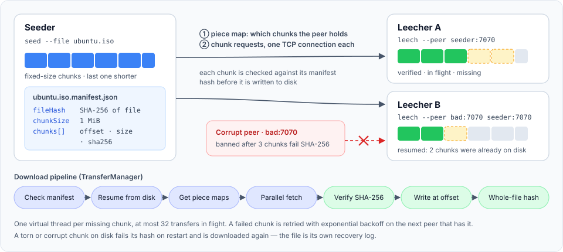

# swarm-share-lite

[](https://github.com/deadboyccc/swarm-share-lite/actions/workflows/gradle.yml)
[](https://github.com/deadboyccc/swarm-share-lite/releases/latest)
[](LICENSE)

> Peer-to-peer, chunk-based file distribution in modern Java 25 — verified, resumable, and fast to start as a native binary.

Copying a large file to many machines bottlenecks at the source. **swarm-share-lite**
splits the file into SHA-256-verified chunks and downloads them in parallel from
every peer that has them. Any machine that finishes a download can seed the file
in turn, so the number of sources grows with the swarm.

<p align="center">
  
</p>

## Features

- **Integrity end to end** — every chunk is checked against its SHA-256 before it touches disk, and the assembled file against the whole-file hash.
- **Parallel downloads** — one virtual thread per missing chunk, at most 32 in flight, across all peers.
- **Resume for free** — restart an interrupted download and only the missing or damaged chunks are fetched; the file is its own recovery log.
- **Survives bad peers** — retries with exponential back-off, fails over to the next peer, and bans a peer once 3 of its chunks fail verification.
- **Clear failures** — one-line errors and meaningful exit codes, never a stack trace.
- **JVM or native** — run on Java 25, or as a single GraalVM native executable that starts in milliseconds.
- **Clean architecture** — a dependency-free domain core behind ports; network and disk are swappable adapters.

## Install

Download from the [latest release](https://github.com/deadboyccc/swarm-share-lite/releases/latest):

| Asset | Runs on |
|-------|---------|
| `swarm-share-<version>-linux-x64` | Linux x86-64 (glibc), no Java needed |
| `swarm-share-<version>.zip` | Any OS with Java 25+ (`bin/swarm-share`, `bin/swarm-share.bat`) |

```bash
chmod +x swarm-share-1.0.0-linux-x64 && mv swarm-share-1.0.0-linux-x64 ~/.local/bin/swarm-share
sha256sum -c SHA256SUMS --ignore-missing   # optional: verify the download
```

Or [build from source](#build-and-run).

## Quick start

On the machine that has the file (progress messages on stderr trimmed):

```console
$ swarm-share seed --file ubuntu.iso --port 7070
Manifest hash: 1ce251bb506e10558235cf3feade0c868b215d47bd9c18523c58737db433f5fd
Total chunks:  10
Manifest file: ubuntu.iso.manifest.json
Listening on port 7070
```

Copy `ubuntu.iso.manifest.json` to the other machines, then on each one:

```console
$ swarm-share leech --manifest ubuntu.iso.manifest.json --peer 192.168.1.10:7070 --output ubuntu.iso
[INFO] Downloading ubuntu.iso (10 chunks) from 1 peer(s)...
[INFO] Pre-allocated 10,485,760 bytes at ubuntu.iso
[INFO] Transfer complete. All 10 chunks verified. fileHash=1ce251bb…
Download complete: ubuntu.iso
```

List several peers — in order of preference — to download from all of them:
`--peer 192.168.1.10:7070 192.168.1.11:7070`. Once a machine has the file it can
`seed` it too.

### Commands

| Command | Purpose |
|---------|---------|
| `seed --file <file> [--port <port>] [--manifest-out <path>]` | Write the manifest and serve the file (port `7070` by default, `0` for any free port) |
| `leech --manifest <path> --peer <host:port>... --output <path>` | Download, verify and resume |
| `build-manifest <file> [<chunkSize>] [-o <path>]` | Write a manifest without serving |
| `download <manifest> <output> <host:port>...` | Positional form of `leech` |
| `help [<command>]` | Usage; every command also takes `--help` |

Exit codes: `0` success, `1` failure (reason on stderr), `2` invalid usage.

## How it works

1. **Manifest** — the seeder splits the file into fixed-size chunks (1 MiB by default) and writes a JSON manifest: offset, size and SHA-256 of every chunk, plus the hash of the whole file.
2. **Validation** — a leecher checks the manifest is consistent before it creates or touches the output file.
3. **Resume** — chunks already on disk are re-hashed; valid ones are kept.
4. **Discovery** — the leecher asks every peer for its piece map, a `BitSet` of the chunks it holds.
5. **Parallel transfer** — each missing chunk is fetched over TCP from the first listed peer that has it, verified, and written straight to its offset.
6. **Resilience** — failed chunks retry with back-off on the next peer; peers that serve corrupt data are banned.
7. **Final check** — the assembled file must match the manifest's whole-file hash.

The full design, wire protocol and rationale are in [ARCHITECTURE.md](ARCHITECTURE.md).

## Architecture

Hexagonal (ports & adapters). Dependencies point inward; the domain has no I/O or framework code.

```
cli ──► transfer ──► manifest ──► core
 └──► networking, storage ──────► core
```

| Module | Responsibility |
|--------|----------------|
| `core` | Domain records (`Manifest`, `ChunkId`, …), ports (`StorageProvider`, `PeerConnector`), SHA-256 |
| `manifest` | Build, serialize (JSON) and validate manifests |
| `storage` | `FileChannelStorage` — positional file I/O and resume scan |
| `networking` | Binary TCP protocol: `TcpChunkServer`, `TcpPeerConnector` |
| `transfer` | `TransferManager` — scheduling, back-pressure, retries, peer bans |
| `cli` | picocli commands wiring the adapters together |

Swapping TCP for TLS, or local disk for another store, only touches `networking` or `storage`.

## Build and run

**Requirements:** Java 25 (the Gradle wrapper fetches Gradle). For the native executable: [GraalVM 25](https://www.graalvm.org/downloads/) with `native-image`, and `GRAALVM_HOME` pointing at it.

```bash
# JVM distribution
./gradlew :cli:installDist
cli/build/install/swarm-share/bin/swarm-share --help

# Native executable (~20 MB, no JVM at runtime)
./gradlew :cli:nativeCompile
cli/build/native/nativeCompile/swarm-share --help
```

The native build needs about 1.5 GB of free memory.

## Testing

```bash
./gradlew build                     # unit + integration + end-to-end (JVM) tests, coverage
./gradlew jacocoAggregatedReport    # coverage of all modules → build/reports/jacoco/
./gradlew :cli:nativeE2eTest        # the end-to-end suite against the native executable
```

| Layer | What runs |
|-------|-----------|
| Unit | Every module, with in-memory fakes instead of mocks |
| Integration | Real TCP on loopback and real files: two-node transfer, dropped connections, corrupt seeder, interrupted-and-resumed download |
| End-to-end | The packaged CLI as separate processes: seed → leech, failover, resume, corrupt-peer ban, clear failures |
| Multi-host | A seeder and two leechers in separate containers on a Docker network (Testcontainers; needs Docker) |

The same end-to-end suite runs against the JVM distribution and the native binary.
v1.0.0: **300+ tests**, aggregated coverage **about 92% of lines and 88% of branches**.

## Status

**v1.0.0** — every phase of the [roadmap](ARCHITECTURE.md#17-phased-roadmap) is implemented and tested. See the [releases](https://github.com/deadboyccc/swarm-share-lite/releases) for what changed in each milestone, and [docs/ASSUMPTIONS.md](docs/ASSUMPTIONS.md) for the decisions taken where the spec was silent.

### Non-goals for v1

- No DHT or tracker — peers are listed on the command line.
- No NAT traversal.
- No encryption — plain TCP (the `PeerConnector` port is where TLS would go).
- Leechers do not serve chunks while still downloading; a finished copy can be seeded.
- No GUI and no persistent peer state.

## Documentation

| Document | For |
|----------|-----|
| [ARCHITECTURE.md](ARCHITECTURE.md) | Design, wire protocol, concurrency model, roadmap, Java reference |
| [docs/ASSUMPTIONS.md](docs/ASSUMPTIONS.md) | Decisions where the spec is ambiguous or silent |
| [CONTRIBUTING.md](CONTRIBUTING.md) | Workflow, standards, how to test |
| [AGENTS.md](AGENTS.md) | Rules for AI coding agents |

## License

[MIT](LICENSE)
